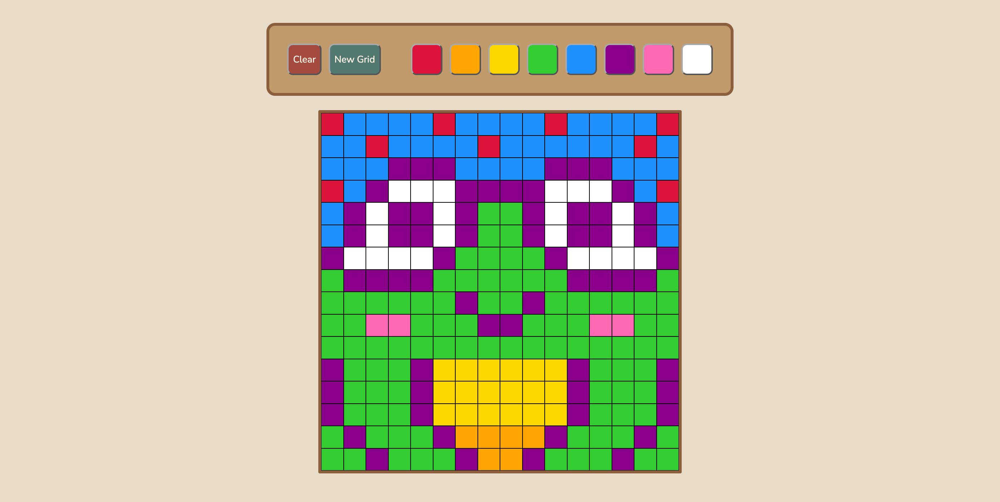

# pixel-canvas

Pixel Canvas is a browser-based canvas that lets you create colorful pixel art by clicking and dragging across a customizable grid.

## Live Demo
https://enaka2.github.io/pixel-canvas/

## Preview
